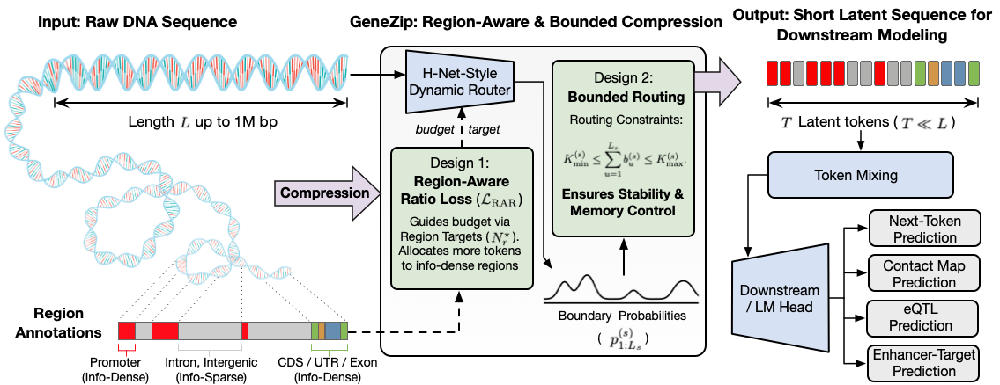

<div align="center">

# GeneZip: Region-Aware Compression for Long-Context DNA Modeling

[](https://pytorch.org/)
[](#environment)
[](https://hydra.cc/)
[](https://openreview.net/pdf?id=E37ysCRa5d)
[](#pretrained-models)
[](LICENSE)

[Project page](https://andyjzhao.github.io/GeneZip/) · [Paper](https://openreview.net/pdf?id=E37ysCRa5d) · [Models](#pretrained-models) · [Getting started](#environment) · [Citation](#citation)

</div>

Official PyTorch implementation of GeneZip, a framework for region-aware DNA compression.

Jianan Zhao, Xixian Liu, Zhihao Zhan, Xinyu Yuan, Hongyu Guo, and Jian Tang.

## Abstract

Long-context DNA modeling is computationally expensive, motivating existing approaches to reduce sequence length through uniform downsampling. However, functional information and sequence redundancy are unevenly distributed across the genome, calling for finer resolution in functionally dense regions and stronger compression of redundant sequence. We introduce GeneZip, a region-aware DNA compression framework that learns where to allocate a limited token budget. Building on H-Net-style dynamic routing, GeneZip combines a Region-Aware Ratio objective, which uses regional labels derived from GENCODE gene annotations to specify compression targets during training, with bounded routing for stable token counts. At inference, it compresses raw DNA without annotations. GeneZip provides three main benefits. First, it preserves predictive utility under high compression: GeneZip-70M achieves 137.6-fold compression with a validation perplexity increase of 0.31 relative to uncompressed Mamba2-84M, and the best average rank across four DNALongBench tasks among compression models with leakage-controlled pretraining. Second, it learns region-aware allocation with emergent repeat-aware compression. Alternative regional priors yield task-dependent performance trade-offs. Without repeat-specific supervision, GeneZip compresses transposable-element-derived and tandem repeats more strongly than matched non-repeat sequence; its tandem-repeat compression preference transfers to a nine-species evaluation panel without further training. Third, it enables efficient long-context modeling: on 450-kb inputs, GeneZip-70M achieves 36.1-fold higher inference throughput than JanusDNA-7.7M on a single H100 GPU.



## Results

GeneZip-70M uses the same pretrained weights across all four tasks, with
separately trained task heads and adapted weights.

| CMP SCC | eQTL AUROC | ETGP AUPRC | TISP PCC | Average rank |
| ---: | ---: | ---: | ---: | ---: |
| 0.1332 | 0.8172 | 0.3746 | 0.3356 | 3.13 |

The average rank is computed across all ten models using the four task
scores rounded to three decimals, with average ranks for ties. GeneZip leads
among **compression models with leakage-controlled pretraining**; the
[complete comparison](results/CHECKPOINTS.md#dnalongbench-results) includes
external-pretraining models.

The **36.1× batched inference throughput** result processes 100 sequences of 450,000 bp
on one H100 80GB with BF16: 6.34 s for GeneZip-70M (batch 7), versus 228.63 s
for JanusDNA-7.7M (batch 9). See the [timing protocol](results/reproduce_release.md#inference-throughput).

## Pretrained models

See [model details and benchmark results](results/CHECKPOINTS.md) and the
[paper result CSV](results/tables/dnalongbench.csv).

The regional multipliers $\mu_r$ are listed in the order **promoter, CDS, UTR,
exon, intron, NIG, DIG**. The target BPT for each region is $N \mu_r$.

### Main models

| Model | Pretraining context | $\mu_r$ | Use |
| --- | ---: | --- | --- |
| [GeneZip-70M](https://huggingface.co/andyjzhao/GeneZip-70M) | 12,800 | (1, 1, 2, 2, 8, 8, 16) | Default; all four main tasks |
| [GeneZip-70M-128K](https://huggingface.co/andyjzhao/GeneZip-70M-128K) | 128,000 | (1, 1, 2, 2, 8, 8, 16) | Pretraining context scaling |
| [GeneZip-636M](https://huggingface.co/andyjzhao/GeneZip-636M) | 12,800 | (1, 1, 2, 2, 8, 8, 16) | Pretraining model scaling |
| [GeneZip-636M-128K](https://huggingface.co/andyjzhao/GeneZip-636M-128K) | 128,000 | (1, 1, 2, 2, 8, 8, 16) | Model/context scaling |

### Ablation models

These checkpoints support the regional-prior ablation in the paper appendix.

| Model | Pretraining context | $\mu_r$ | Use |
| --- | ---: | --- | --- |
| [GeneZip-Regulome](https://huggingface.co/andyjzhao/GeneZip-Regulome) | 12,800 | (1, 16, 2, 4, 2, 2, 4) | N=64 regional prior |
| [GeneZip-PromoterDistal](https://huggingface.co/andyjzhao/GeneZip-PromoterDistal) | 12,800 | (1, 16, 8, 8, 2, 2, 4) | N=64 regional prior |
| [GeneZip-Intergenic](https://huggingface.co/andyjzhao/GeneZip-Intergenic) | 12,800 | (32, 16, 8, 4, 2, 4, 1) | N=32 regional prior |

This repository provides pretrained weights, pretraining code, and code for
training and evaluating CMP, eQTL, ETGP and TISP on DNALongBench. Each task
starts from the pretrained weights using the commands below.

## Environment

Linux x86_64, an NVIDIA GPU and a CUDA 12.6-compatible driver/toolkit are
required for model execution. The software has been tested on A100 80GB GPUs.
The lockfile uses Python 3.12, PyTorch 2.8/CUDA 12.6, flash-attn 2.8.3, mamba-ssm 2.3.0 and
causal-conv1d 1.6.0.

```sh
git clone https://github.com/AndyJZhao/GeneZip.git
cd GeneZip
uv venv --python 3.12
uv sync
source .venv/bin/activate
```

Run shell entrypoints from the repository root. W&B is optional for downstream
commands (`USE_WANDB=true`). `HF_USER` selects the Hugging Face namespace and defaults to `andyjzhao`.

## DNALongBench training and evaluation

All four wrappers default to the public `andyjzhao/GeneZip-70M` weights.
Their default commands download the checkpoint automatically:

```sh
bash shell/dnalongbench/cmp.sh
bash shell/dnalongbench/eqtl.sh
bash shell/dnalongbench/etgp.sh
bash shell/dnalongbench/tisp.sh
```

To download the model into a local directory:

```sh
python - <<'PYTHON'
from huggingface_hub import snapshot_download
snapshot_download(
    repo_id="andyjzhao/GeneZip-70M",
    local_dir="./pretrained/GeneZip-70M",
)
PYTHON
CKPT=./pretrained/GeneZip-70M bash shell/dnalongbench/etgp.sh
```

The CMP command defaults to HFF. To evaluate all five cell lines:

```sh
for SUBSET in HFF H1hESC GM12878 IMR90 HCT116; do
  SUBSET="$SUBSET" bash shell/dnalongbench/cmp.sh
done
```

The eQTL command defaults to Artery_Tibial. Use `CELL_TYPE` to select one of the
[nine tissues](results/CHECKPOINTS.md#task-subsets). Both eQTL and ETGP use 450,000 bp, seed 1, no LoRA,
frozen embeddings/encoder/router, LR 2e-4, three epochs and best validation AUROC.
Their compression regularizer targets 128 BPT (alpha 0.03), independently of
the pretraining N=32 anchor. eQTL, ETGP and TISP use WD 0.1. TISP freezes
embeddings, encoders and routers. eQTL, ETGP and TISP all disable the extra
routing floor and apply ceilings of `[70000,70000]` during training and
validation/test; dynamic routing and the first-valid-token rule remain enabled. CMP evaluates every 200 steps. The same eQTL/ETGP/TISP
protocol applies to the [regional-prior models](results/CHECKPOINTS.md#regional-prior-ablations).

To repeat eQTL or ETGP evaluation after training, reuse the same model, subset
and checkpoint directory. These examples use the wrappers' default settings
and restore the checkpoint selected by validation AUROC:

```sh
python src/scripts/finetune_dlb_binary_classification.py task=eqtl \
  cell_type=Artery_Tibial save_dir=./temp/eQTL_ckpt training.do_train=false test_load=best
python src/scripts/finetune_dlb_binary_classification.py task=etgp \
  cell_type=CRISPRi_EPI_K562_hg19 save_dir=./temp/ETGP_ckpt training.do_train=false test_load=best
```

To evaluate a trained TISP checkpoint, use the same pretrained model and task
settings with a fresh output directory. For a completed 5,000-step run:

```sh
python src/scripts/finetune_dlb_tisp.py task=tisp \
  evaluation_checkpoint=/path/to/training/best_model.pt \
  completed_training_steps=5000 train_steps=5000 dirs.output=./output/tisp-evaluation
```

Set `completed_training_steps` and `train_steps` to the training run's completed
step count. The command evaluates the validation and test splits.

eQTL/ETGP/TISP training performs validation selection and held-out test evaluation.
CMP reports validation/test metrics every 200 head updates.
Training produces the task checkpoints used for evaluation.
When changing the eQTL tissue or pretrained model, use a distinct `SAVE_DIR`
(e.g. `CELL_TYPE=Whole_Blood SAVE_DIR=./temp/eqtl_Whole_Blood bash shell/dnalongbench/eqtl.sh`)
and pass that same directory and `ckpt` to independent evaluation.

Data loaders download the public datasets configured in `configs/data.yaml` and
`configs/main.yaml`. GENCODE uses Parquet with its original `train`/`valid` split;
DNALongBench uses its published task directories. Set `offline_mode=true` only
after the required data and model files are available locally.

## Pretraining templates

```sh
bash shell/pretrain/GeneZip-70M-12.8K-template.sh
bash shell/pretrain/GeneZip-70M-128K-template.sh
bash shell/pretrain/GeneZip-636M-12.8K-template.sh
bash shell/pretrain/GeneZip-636M-128K-template.sh
```

128K training continues from the same-size 12.8K checkpoint. Each stage uses its
own training budget. The templates default to eight GPUs. Regional targets
are declared in `configs/prior/`, with N=64 for Regulome and PromoterDistal.
Regulome, PromoterDistal and Intergenic use routing floors `[8,8]` and caps
`[5000,2000]`. The 636M templates use `[3000,3000]` at 12.8K and `[30000,10000]`
at 128K.

Evaluate the downloaded 70M checkpoint on the pretraining validation split:

```sh
python src/scripts/pretrain_genezip.py task=pretrain \
  pretrained_ckpt=./pretrained/GeneZip-70M training.do_train=false training.do_eval=true
```

## Citation

If you use GeneZip in your research, please cite:

```bibtex
@inproceedings{zhao2026genezip,
  title = {GeneZip: Region-Aware Compression for Long-Context DNA Modeling},
  author = {Zhao, Jianan and Liu, Xixian and Zhan, Zhihao and Yuan, Xinyu and Guo, Hongyu and Tang, Jian},
  booktitle = {Advances in Neural Information Processing Systems},
  year = {2026},
  url = {https://openreview.net/pdf?id=E37ysCRa5d}
}
```

## Questions and contributions

Use [GitHub Issues](https://github.com/AndyJZhao/GeneZip/issues) for questions and
bug reports. For a bug report, include the command, environment and traceback.
Contributions are welcome; see [CONTRIBUTING.md](CONTRIBUTING.md).

## License

Code is licensed under [Apache-2.0](LICENSE). See [THIRD_PARTY_NOTICES.md](THIRD_PARTY_NOTICES.md)
for upstream projects and licenses.
